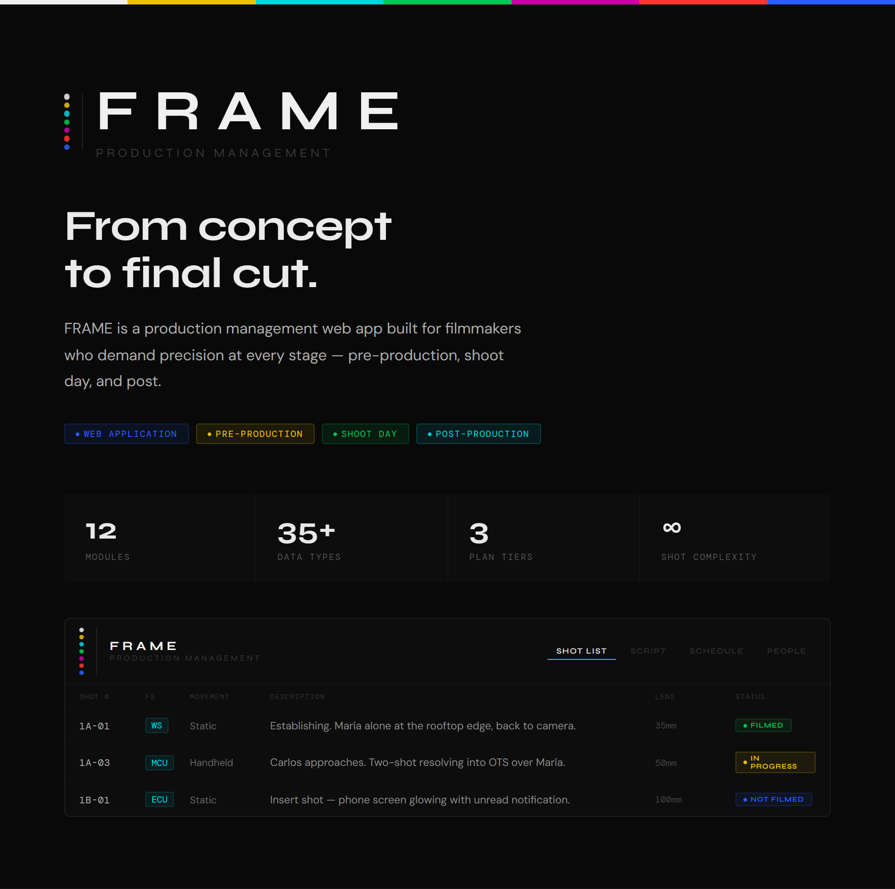
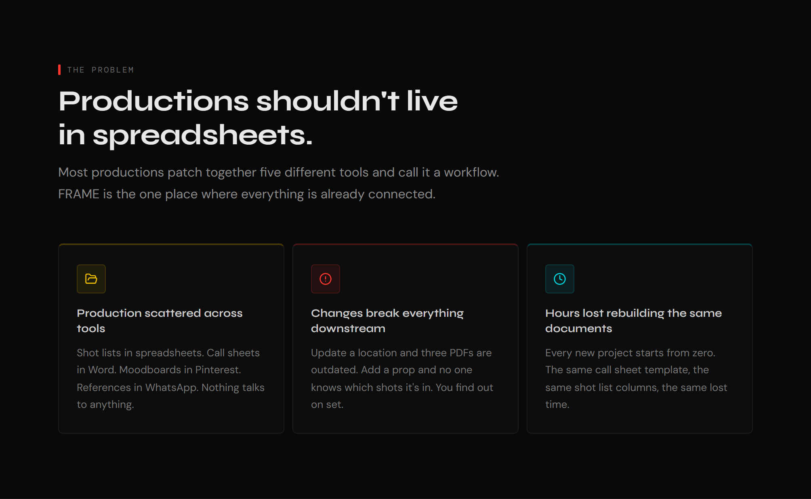
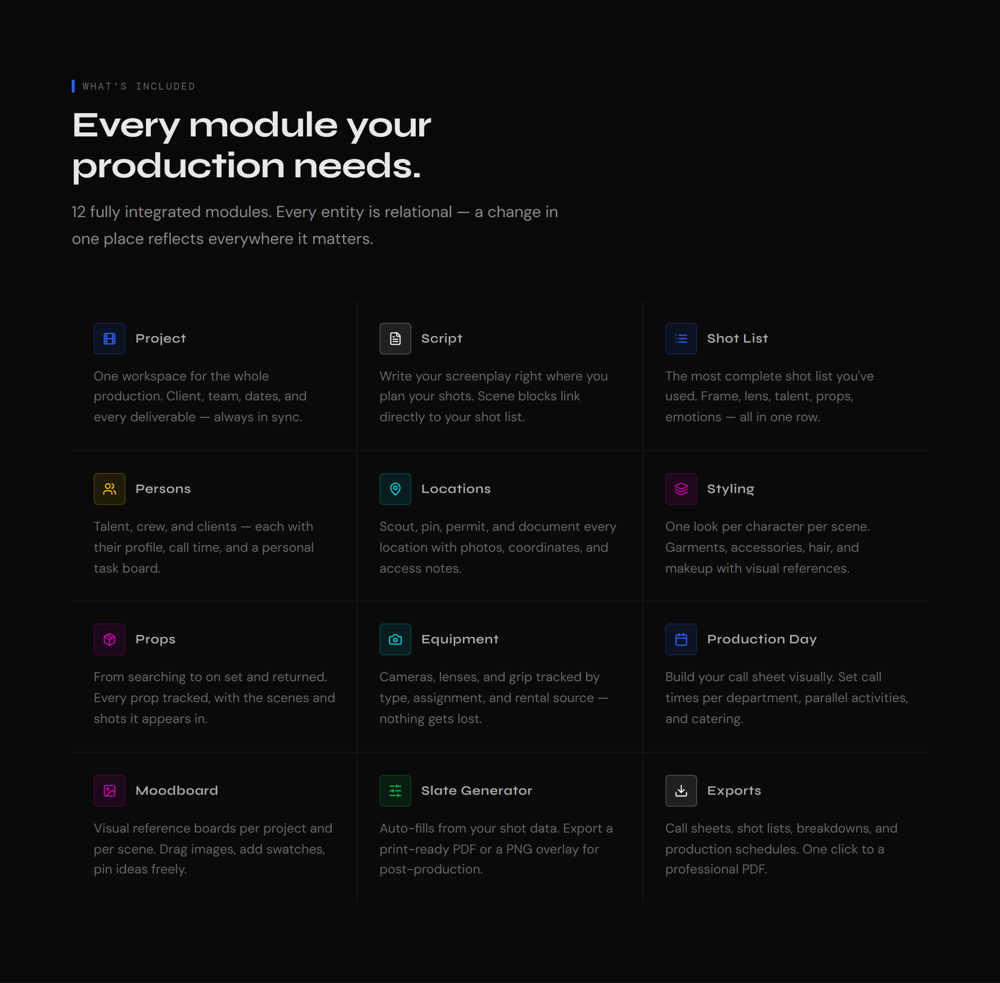
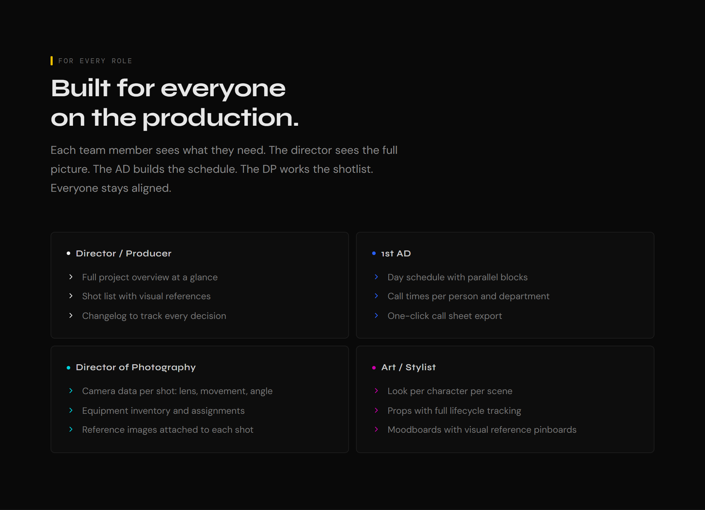
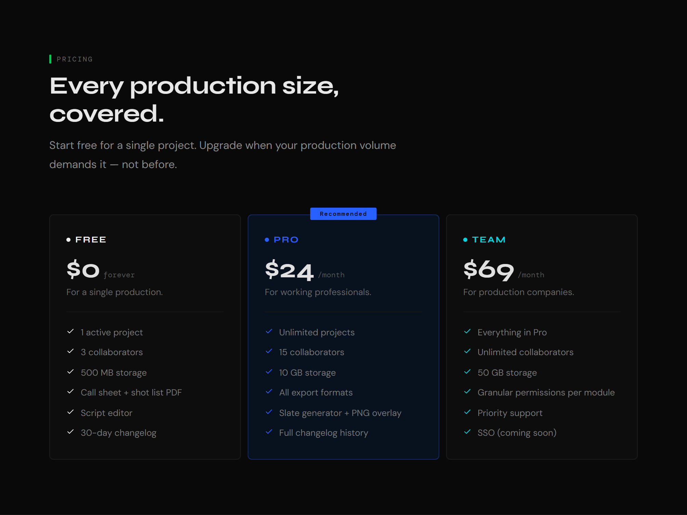
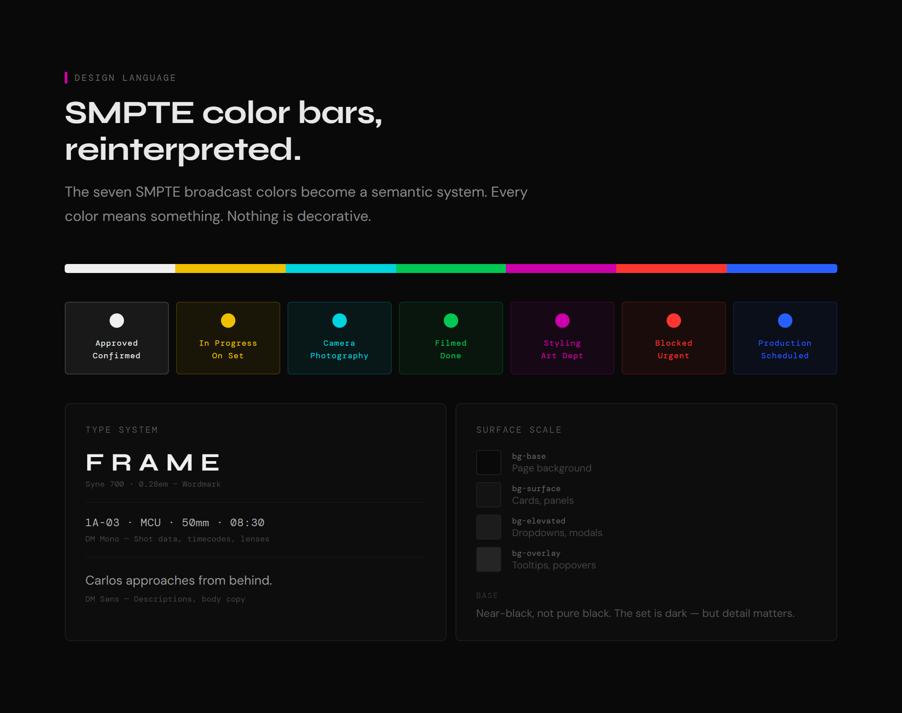
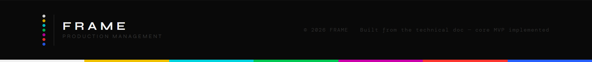

<p align="center">
  
</p>

<p align="center">
  
</p>

<p align="center">
  
</p>

<p align="center">
  
</p>

<p align="center">
  
</p>

<p align="center">
  
</p>

<p align="center">
  
</p>

---

## Run it

```bash
pnpm install
npx supabase start          # local Postgres + Auth + Storage (Docker)
# fill the .env files from the printed keys (see docs/DEVELOPMENT.md)
pnpm db:migrate && pnpm db:seed
pnpm dev                    # web :4000 · api :4001
```

**Demo login:** `demo@frame.app` / `frame-demo-1234` — a fully populated commercial
production with shotlist, people & tasks, locations, props, equipment and a
production day ready to export as a call sheet.

## Docs

- **[docs/DEVELOPMENT.md](docs/DEVELOPMENT.md)** — stack, local setup, architecture notes, cloud deploy.
- **[TECHNICAL DOC.md](TECHNICAL%20DOC.md)** — full product & architecture spec (§0: implementation resolutions).
